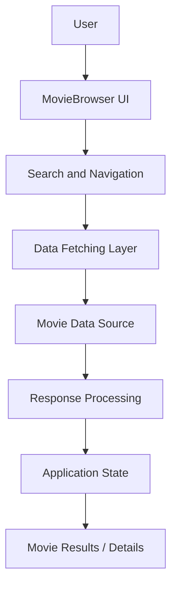
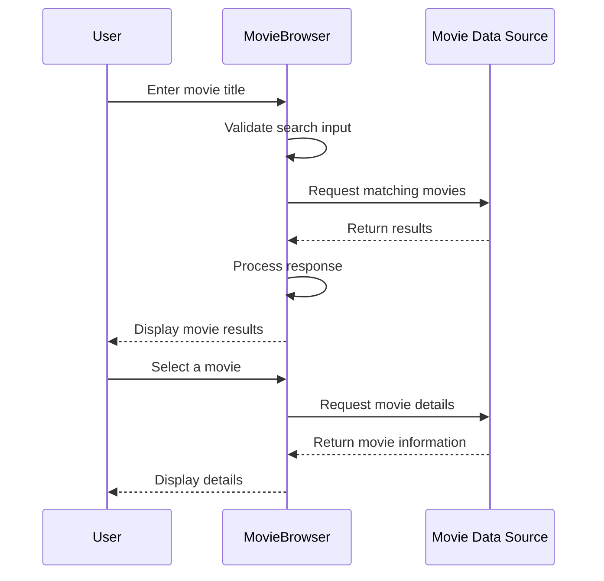

# 🎬 MovieBrowser

### Discover Movies. Explore Details. Find Your Next Watch.

MovieBrowser is a web application designed to simplify movie discovery by allowing users to search for movies and explore their details through a centralized interface.

Built primarily with **TypeScript, CSS, and HTML**, the project focuses on creating an interactive movie-browsing experience while exploring frontend engineering concepts such as asynchronous data fetching, API integration, state management, responsive interfaces, and performance optimization.

## 🛠️ Tech Stack

| Technology | Purpose |
|---|---|
| TypeScript | Type-safe application development |
| CSS | Application styling and responsive layouts |
| HTML | Application structure and markup |
| Movie Data API | External movie information, subject to integration verification |
| Git & GitHub | Version control and source management |

## 🎯 Problem Statement

Finding information about movies often involves navigating multiple pages or services to compare titles, release dates, ratings, and other details.

MovieBrowser aims to simplify this experience by providing a single interface for searching and exploring movie information.

From an engineering perspective, the challenge is to build a responsive, reliable interface that communicates with an external data source and presents results efficiently.

The application addresses the following concerns:

- **Movie discovery:** Help users locate movies through search.
- **Information accessibility:** Present movie details in an understandable format.
- **Asynchronous data handling:** Manage requests and responses without blocking the interface.
- **User experience:** Provide appropriate feedback during loading, empty-result, and error states.
- **Maintainability:** Organize frontend logic into understandable, reusable units.

## ✨ Core Features

The repository's stated purpose establishes two central capabilities:

### 🔍 Movie Search

Allow users to search for movies and browse matching results.

A useful search interface should support clear input handling, readable results, and feedback when no matches are found.

### 🎞️ Movie Details

Allow users to view additional information about a selected movie.

Depending on the connected movie data source, this may include:

- Movie title
- Release date
- Poster artwork
- Plot or synopsis
- Genre
- Ratings
- Cast and crew

The exact metadata fields depend on the implemented API integration.

## 🏗️ Application Architecture

MovieBrowser is a frontend-oriented application centered around retrieving and displaying movie information.

### High-Level Architecture



This represents a proposed logical architecture rather than a verified source-code dependency graph.

### Architectural Responsibilities

| Layer | Responsibility |
|---|---|
| Presentation | Display search controls, movie results, and details |
| Interaction | Process user input and selection |
| Data access | Retrieve movie information |
| Data modeling | Define consistent structures for movie records |
| State management | Coordinate loading, results, errors, and selections |
| Styling | Maintain a responsive and accessible interface |

### Why a Frontend-Focused Architecture?

A movie discovery application primarily performs read-oriented operations.

When movie information is supplied by an external API, a dedicated application backend may not be necessary for a small-scale project.

This approach reduces infrastructure complexity and allows development to focus on the browsing experience.

However, a backend or serverless proxy may become necessary to protect API credentials, enforce request limits, introduce shared caching, or support user-specific functionality.

## 🔎 Movie Search Workflow

Searching for movies involves more than displaying an input field.

The application must translate user input into a request, handle the response, and update the interface appropriately.

### Search Flow



This is a representative search-and-detail flow. The actual implementation may use a different request sequence.

### Search Design Considerations

**1. Input Validation**

Empty or whitespace-only queries should not trigger unnecessary requests.

**2. Loading Feedback**

Users should receive feedback while requests are being processed.

**3. Error Handling**

Network failures, API errors, and malformed responses should be handled without crashing the interface.

**4. Empty Results**

A search that returns no movies should be treated as a valid outcome rather than an application failure.

**5. Request Coordination**

When users submit searches rapidly, older responses should not overwrite newer results.

## 🔄 State Management

MovieBrowser's interface can be modeled around several distinct categories of state.

### 1. Search State

Represents the current search input and submitted query.

```ts
interface SearchState {
  query: string;
  submittedQuery: string;
}
```

### 2. Movie Data State

Represents the collection of retrieved movies and the currently selected movie.

```ts
interface Movie {
  id: string;
  title: string;
  releaseDate?: string;
  posterUrl?: string;
  overview?: string;
}

interface MovieDataState {
  results: Movie[];
  selectedMovie: Movie | null;
}
```

### 3. Request State

Represents the lifecycle of asynchronous requests.

```ts
type RequestStatus =
  | "idle"
  | "loading"
  | "success"
  | "error";

interface RequestState {
  status: RequestStatus;
  error: string | null;
}
```

These are illustrative TypeScript models, not copied definitions from the repository.

### Why Separate These States?

Separating search input, retrieved data, and request status makes the application easier to reason about.

For example, a failed request should not necessarily clear the user's search input.

Similarly, selecting a movie should not require rebuilding the entire search result collection.

### State Management Principle

**Keep the source data minimal and derive presentation values when needed.**

This avoids duplicating values that can be calculated from existing application state.

## 🌐 External API Integration

A movie browser typically depends on a movie database or content API for up-to-date movie information.

The exact provider used by this repository could not be verified.

### Why Use an External API?

Maintaining a complete movie catalog independently would require significant infrastructure and continuous data updates.

An external provider can supply structured movie metadata without requiring the application to manage its own movie database.

### API Integration Considerations

| Concern | Engineering Approach |
|---|---|
| Network latency | Display loading states |
| Rate limits | Avoid redundant requests |
| Invalid responses | Validate required fields |
| Missing metadata | Provide sensible fallbacks |
| Request failures | Show recoverable error messages |
| API credentials | Avoid exposing sensitive secrets |
| Repeated searches | Consider caching suitable responses |

### Data Normalization

External APIs may return inconsistent or optional fields.

A normalization layer can transform API-specific responses into a consistent application model.

For example:

```ts
interface MovieSummary {
  id: string;
  title: string;
  releaseYear?: number;
  posterUrl?: string;
}

function normalizeMovie(
  raw: Record<string, unknown>
): MovieSummary {
  return {
    id: String(raw.id ?? ""),
    title: String(raw.title ?? "Untitled"),
    releaseYear:
      typeof raw.releaseYear === "number"
        ? raw.releaseYear
        : undefined,
    posterUrl:
      typeof raw.posterUrl === "string"
        ? raw.posterUrl
        : undefined,
  };
}
```

A real implementation should adapt this model to the API's documented response schema and validate required fields.

## ⚖️ Engineering Trade-offs

| Decision | Benefit | Trade-off |
|---|---|---|
| TypeScript | Compile-time type checking | Additional type definitions |
| External movie API | Access to an existing movie catalog | Network and provider dependency |
| Client-oriented architecture | Simpler deployment and development | Limited control over external requests |
| On-demand fetching | Avoids downloading unnecessary data | Repeated network requests |
| Local UI state | Straightforward interaction management | Complexity can increase with shared state |
| Response caching | Potentially faster repeated searches | Cache invalidation and freshness concerns |
| Responsive design | Better usability across devices | Additional layout and testing work |

### Why Not Build a Custom Movie Database?

For a project focused on movie discovery, independently collecting and maintaining movie metadata would add significant complexity.

An external data source allows development effort to remain focused on search, data presentation, and user experience.

A dedicated database would become more valuable if the application introduced features such as personal watchlists, ratings, reviews, or saved preferences.

## 🧩 Technical Challenges

### 1. Managing Asynchronous Requests

Search results depend on network operations that may complete in an unpredictable order.

If multiple searches are submitted quickly, an earlier request may finish after a later one.

Without appropriate request coordination, stale results can replace the latest search results.

Potential solutions include request cancellation, request identifiers, or query-aware response handling.

### 2. Handling Incomplete Movie Data

Movie metadata is not always complete.

Some movies may lack poster images, release dates, ratings, or descriptions.

The interface should handle missing information gracefully rather than assuming every field exists.

### 3. Maintaining Consistent UI State

Search input, results, selected movies, and request status may change independently.

Clear state boundaries help prevent inconsistent rendering and unintended updates.

### 4. Designing Responsive Movie Cards

Movie posters and descriptions vary in size.

The UI must balance readable information, consistent card layouts, and usability across different screen sizes.

### 5. Handling API Failures

External services may return errors, time out, or become temporarily unavailable.

A robust application should provide meaningful feedback and allow users to retry appropriate operations.

These are engineering challenges relevant to the project's architecture, not independently verified accounts of specific bugs or solutions in the source code.

## 🚀 Performance Optimization

A search-driven application should prioritize responsiveness while minimizing unnecessary requests and rendering work.

### 1. Debouncing Search Requests

If the application searches as users type, debouncing can reduce the number of API requests.

Instead of requesting results after every keystroke, the application can wait briefly until the user pauses.

For explicit submit-based searches, debouncing may not be necessary.

### 2. Caching Repeated Searches

Frequently repeated queries can potentially reuse cached results.

Caching reduces network requests but requires an appropriate freshness policy.

### 3. Lazy Loading Images

Movie posters can be loaded as they approach the visible viewport.

This reduces unnecessary image downloads, especially when search results contain many movies.

### 4. Pagination

Large result sets should be paginated or incrementally loaded rather than rendered all at once.

### 5. Avoiding Unnecessary Renders

Derived state and component-level optimization can reduce repeated rendering work.

Optimization should be guided by profiling rather than applied indiscriminately.

### 6. Handling Outdated Requests

Cancelling or ignoring obsolete search requests helps prevent wasted work and stale results.

**Performance note:** These are recommended optimization strategies. Specific implementations and measured performance improvements have not been verified.

## 📈 Scaling to 100,000 Users

For a movie browsing application, scaling depends primarily on concurrent traffic, search frequency, API quotas, and the volume of movie metadata transferred.

### 1. Introduce an API Proxy

Move requests requiring private credentials behind a backend or serverless endpoint.

This provides greater control over authentication, request validation, and rate limiting.

### 2. Add Shared Caching

Use a shared cache for frequently requested movie details and popular searches.

This can reduce repeated upstream API calls.

### 3. Use a CDN

Serve static assets through a content delivery network to reduce loading times across geographic regions.

### 4. Implement Rate Limiting

Protect API endpoints from excessive requests and help control third-party API usage.

### 5. Optimize Data Transfer

Request only necessary metadata where the provider supports it, paginate results, and use appropriate image sizes.

### 6. Introduce Observability

Monitor:

- Search request latency
- API error rates
- Cache hit rates
- Third-party API quota usage
- Client-side rendering performance
- Network request volume

### 7. Add Persistent Storage When Needed

If features such as watchlists, user ratings, or recommendations are introduced, a database and user authentication layer may become necessary.

### Scaling Philosophy

**Keep the application simple while usage is modest, and introduce infrastructure in response to measured bottlenecks.**

## 📁 Project Structure

The verified repository root contains an application directory:

```text
MovieBrowser/
└── moviebrowser/       # Application source and configuration
```

The repository also contains TypeScript, CSS, and HTML files.

The nested directory structure could not be retrieved during this review, so a more detailed source tree should be documented after inspecting the application files.

## 💻 Getting Started

### Prerequisites

- Git
- Node.js and npm, if required by the project's frontend tooling
- Any API credentials required by the movie data provider

### 1. Clone the Repository

```bash
git clone https://github.com/RittickDatta/MovieBrowser.git
cd MovieBrowser/moviebrowser
```

### 2. Install Dependencies

If the application uses an npm-based development workflow:

```bash
npm install
```

### 3. Configure API Access

If the application requires a movie API key, configure it according to the source code and the frontend framework's environment-variable conventions.

Do not commit private API credentials to the repository.

### 4. Run the Application

Use the development command defined in `moviebrowser/package.json`.

For example, if the project defines a `dev` script:

```bash
npm run dev
```

The exact installation, development, build, and test commands should be verified from the application's package manifest before publishing this section.

## 🔮 Future Improvements

Potential enhancements include:

- Advanced search filters by genre, release year, or rating
- Sorting search results
- Personalized watchlists
- Favorite movies
- Search history
- Movie recommendations
- Improved keyboard accessibility
- Dark and light themes
- Cached search results
- Automated component and API tests
- Improved loading and error states
- Performance monitoring

These are possible extensions rather than confirmed existing features.

## 👨‍💻 Author

**Rittick Datta**

GitHub: [@RittickDatta](https://github.com/RittickDatta)

Repository: [MovieBrowser](https://github.com/RittickDatta/MovieBrowser)

---

*MovieBrowser — Making Movie Discovery Simple.*
